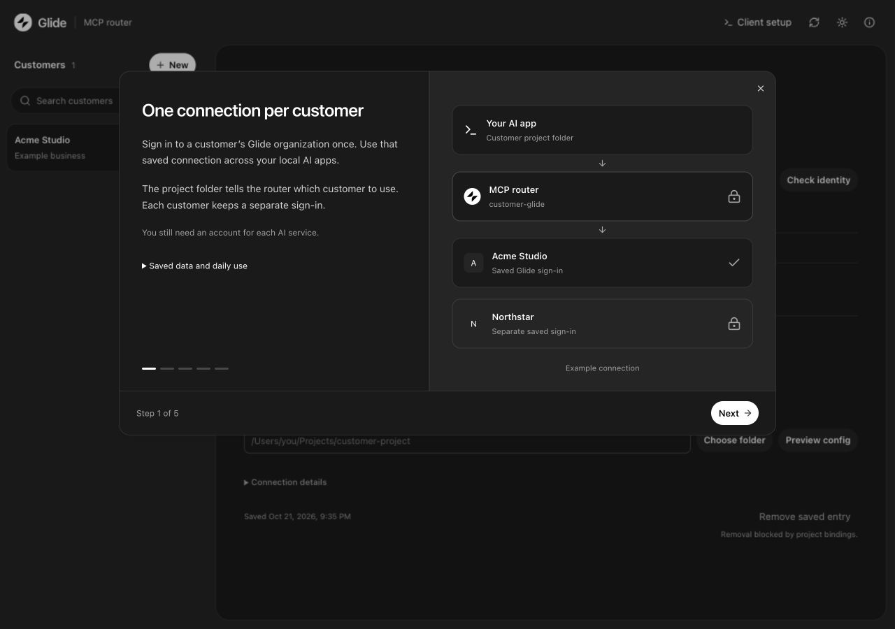

# Customer MCP Router

[](https://github.com/evanfurniss-dev/mcp-customer-router/actions/workflows/main.yaml)
[](LICENSE)

Connect each customer's Glide organization once, then use that saved connection from Claude Code and Codex. The router links a local project folder to one customer and checks the organization before allowing tool calls.



## Install

On macOS with [Homebrew](https://brew.sh):

```sh
brew install evanfurniss-dev/tap/mcp-customer-router
mcp-customer-router service install --open
```

Homebrew installs Node and the application. The dashboard opens at `http://127.0.0.1:4773` and starts at login. Each person signs in to their own Glide organizations; the package contains no customer records or credentials.

Open it each day with:

```sh
mcp-customer-router open
```

You can close the browser and Terminal. The Mac must stay awake for local agent work to continue. The router manages its own macOS user service; use its `service` commands rather than `brew services`.

## Set up a customer

1. Select **New**. Enter a name, business label, and the organization ID from the customer's Glide URL, after `/o/`.
2. Select **Connect Glide**, complete sign-in, and choose that organization. If the browser does not open, select **Open Glide sign-in**. Wait for **Organization verified**.
3. Select **Choose folder**, then **Preview config**. Review any existing Glide connections and choose **Remove** or **Ignore** for each. Apply the configuration.
4. Open that folder in your AI client and start a fresh session. Accept any project trust or MCP approval prompts. Ask the agent to list projects through `customer-glide` and check the organization before making changes.

The walkthrough opens on the first visit. The **ⓘ** button opens it again. **Client setup** provides instructions for each supported local client.

### Choose a client

| Client | Setup scope |
| --- | --- |
| T3 Code | Local Claude Code or Codex provider in the linked folder |
| Claude Code CLI | Run `claude` in the linked folder and approve its project MCP entry |
| Claude app | Local **Code** tab; the guide does not configure chat or Cowork |
| Codex app | Local project on the same Mac; the project must be trusted |
| Codex CLI | Run `codex` in the linked folder and check `/mcp` |
| Conductor | Link each workspace's actual Git worktree folder before starting its agent |

Claude app and Conductor guides are based on their documentation; live router trials for those two clients remain open. Each AI provider still needs its own account. See [client setup and verification limits](docs/CLIENT-SETUP.md).

### Review existing connections

**Preview config** detects other Glide entries in supported project and user settings. **Ignore** keeps an entry for this review. **Remove** takes effect only when you select **Apply and remove N**. The review shows when removal affects other projects.

Changed files receive private backups, listed under **Settings backups** after Apply. To undo a removal, copy the required entry from its backup into the current settings file. Sign-in caches remain. If a settings file changes after preview, preview again before applying.

## How it works

The router saves a separate Glide authorization for each customer. Linking a folder adds a `customer-glide` entry to `.mcp.json` and `.codex/config.toml`. Each client starts its own bridge process, which uses the customer's shared credential store and checks the saved folder binding and organization identity.

By default, customer records, bindings, credentials, and logs live in `~/.mcp-customer-router/`. Settings backups stay beside the original files. The dashboard listens only on `127.0.0.1`; each client bridge can continue with the dashboard closed.

**Check identity** reuses the saved authorization. **Reconnect Glide** starts a fresh authorization for that customer and invalidates its older router sessions. Open fresh client sessions after reconnecting. A separate folder or Git worktree needs its own binding.

## Update or remove

```sh
brew update
brew upgrade evanfurniss-dev/tap/mcp-customer-router
mcp-customer-router service restart
```

Stop active sign-in or identity checks before restarting, then open fresh agent sessions. Homebrew connections use stable installation paths. When moving from a source install, install the Homebrew service and preview/apply each linked folder to update matching executable paths. The router refuses a change to a different customer or folder.

To remove the application while keeping saved customer data:

```sh
mcp-customer-router service uninstall
brew uninstall mcp-customer-router
```

## Scope and limits

- The current connector targets Glide's MCP endpoint, `https://mcp.glideapps.dev/mcp`.
- Connections are separated within one macOS account. An agent with broad file access can read other credential directories. This is not a sandbox for untrusted tenants.
- Execution stays on the Mac. Cloud hosting and scheduled agent runs are outside this release.
- Credentials use private files. Removing a saved customer retains those files and does not revoke access at Glide.
- Other client connections and provider overrides can still expose tools. Check the active MCP list in each client.
- A timed-out or cancelled remote write may have completed. Read back its result before retrying.

See [verification evidence](docs/VERIFICATION.md) for tested paths and remaining checks. Intel Mac operation and a fresh user's complete sign-in flow still need separate validation.

## Development and support

Use `mcp-customer-router --help` for commands, or `mcp-customer-router service status` to inspect the local service.

[Contributing and source setup](CONTRIBUTING.md) · [Report a bug](https://github.com/evanfurniss-dev/mcp-customer-router/issues/new/choose) · [Security policy](SECURITY.md) · [Changelog](CHANGELOG.md) · [Release process](docs/RELEASING.md)

## Attribution

Built on [mcp-remote](https://github.com/punkpeye/mcp-remote), based on commit `71cadf3aaa935608d5e14d472a59e9583ebb9505`. The upstream bridge, copyright, and [MIT license](LICENSE) are retained. See the [upstream README](docs/UPSTREAM-README.md) and [UI source and license record](docs/UI-SOURCES.md).

This is an independent project. Glide and the named AI clients are trademarks of their respective owners; their names describe compatibility and do not imply endorsement.
